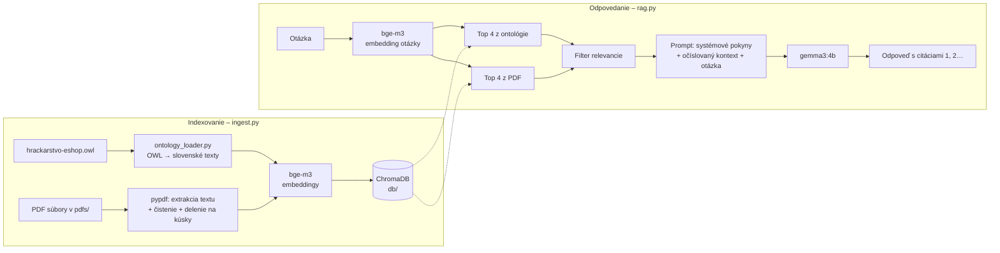
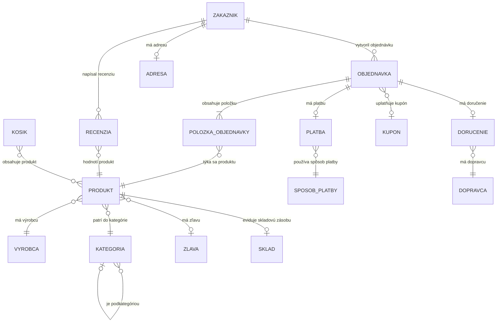

# Hračkárska poradňa – dokumentácia

Lokálny RAG systém (Retrieval-Augmented Generation) pre internetový obchod s hračkami.
Odpovedá po slovensky na otázky o katalógu e-shopu, produktoch, pravidlách hier a výrobcoch.
Ako zdroje používa OWL ontológiu e-shopu a PDF dokumenty. Pri každej odpovedi uvádza, z ktorých zdrojov čerpal.
Celý systém beží na lokálnom počítači a nič sa neposiela na internet.

## Obsah
1. [Cieľ projektu](#1-cieľ-projektu)
2. [Architektúra](#2-architektúra)
3. [Použité technológie](#3-použité-technológie)
4. [Ontológia e-shopu](#4-ontológia-e-shopu)
5. [PDF dokumenty](#5-pdf-dokumenty)
6. [Spracovanie dát (ingest)](#6-spracovanie-dát-ingest)
7. [Vyhľadávanie a generovanie odpovede](#7-vyhľadávanie-a-generovanie-odpovede)
8. [Webové rozhranie a API](#8-webové-rozhranie-a-api)
9. [Inštalácia a spustenie](#9-inštalácia-a-spustenie)
10. [Testovanie](#10-testovanie)
11. [Obmedzenia a možné rozšírenia](#11-obmedzenia-a-možné-rozšírenia)
12. [Štruktúra súborov](#12-štruktúra-súborov)

---

## 1. Cieľ projektu

Cieľom bolo vytvoriť asistenta, ktorý:
- čerpá z **ontológie e-shopu**: produkty, ceny, kategórie, výrobcovia, zákazníci, objednávky, platby, doručenie a recenzie,
- čerpá z **PDF dokumentov k produktom**: katalóg LEGO, pravidlá hier, návody a výročné správy výrobcov,
- odpovedá **po slovensky** a **len na základe týchto zdrojov**; ku každému tvrdeniu uvedie citáciu zdroja,
- beží **lokálne** cez Ollamu, bez platených API a bez posielania dát von.

Bez RAG by jazykový model o konkrétnom e-shope nič nevedel. Pri jemnom dolaďovaní (fine-tuning) by sa model musel pretrénovať pri každej zmene dát. RAG pri každej otázke vyhľadá relevantné úryvky a dá ich modelu ako kontext. Nové dáta preto stačí len znova zaindexovať.

## 2. Architektúra

Systém má dve fázy: **indexovanie**, ktoré sa spúšťa raz po zmene dát, a **odpovedanie**, ktoré prebehne pri každej otázke.



K jadru (`rag.py`) sa dá pristupovať dvoma spôsobmi:
- `ask.py` je príkazový riadok,
- `app.py` je webový server (FastAPI), ktorý obsluhuje rozhranie `web/index.html`.

## 3. Použité technológie

| Technológia | Úloha | Prečo práve táto |
|---|---|---|
| **Ollama** | lokálny beh jazykových modelov | jednoduchá inštalácia na Windows, HTTP API, správa modelov |
| **gemma3:4b** | generovanie odpovedí | malý model (~3,3 GB), ktorý beží aj na procesore (testovací PC: 14 GB RAM, integrovaná grafika AMD 780M) a slušne zvláda slovenčinu |
| **bge-m3** | embeddingy (prevod textu na vektory) | viacjazyčný model; slovenská otázka nájde aj anglický či nemecký text |
| **ChromaDB** | vektorová databáza | lokálna, ukladá sa na disk, podporuje filtrovanie podľa metadát |
| **rdflib** | načítanie OWL ontológie | štandardná knižnica pre RDF/OWL v Pythone |
| **pypdf** | extrakcia textu z PDF | čistý Python, bez externých programov |
| **FastAPI + uvicorn** | webový server | jednoduché API so streamovaním odpovede |
| **HTML/CSS/JS** (bez frameworku) | webové rozhranie | jeden súbor, nič sa nekompiluje, funguje aj offline |

**Prečo malý model:** väčšie modely (7–8 miliárd parametrov a viac) by na testovacom počítači odpovedali výrazne pomalšie. Pri RAG model fakty nemusí poznať sám; stačí, aby dobre zhrnul dodaný kontext. Model sa dá zmeniť v `config.py` (`CHAT_MODEL`).

## 4. Ontológia e-shopu

Súbor `hrackarstvo-eshop.owl` (RDF/XML, vytvorený vo WebProtégé) opisuje doménu e-shopu s hračkami.

| Prvok | Počet |
|---|---|
| RDF trojice | 757 |
| Triedy (`owl:Class`) | 22 |
| Objektové vlastnosti (vzťahy) | 17 |
| Dátové vlastnosti (atribúty) | 40 |
| Individuá (konkrétne záznamy) | 53 |

### 4.1 Hlavné pojmy a vzťahy



**Atribúty produktu** (výber): názov, popis, cena, pôvodná cena, kód produktu SKU, čiarový kód, značka, farba, materiál, rozmery, hmotnosť v kg, odporúčaný vek od/do, počet kusov na sklade, dostupnosť, je novinka, je najpredávanejší, URL obrázka.

**Individuá:**
- 23 produktov a 1 hračka od výrobcov LEGO, Mattel, Hasbro, Ravensburger, Playmobil a Spin Master, napr. *LEGO City Policajná stanica*, *Barbie domček*, *Monopoly Classic*, *Dixit*,
- 10 kategórií,
- 6 výrobcov,
- vzorový zákazník s adresou, objednávkou, platbou, doručením, kupónom a recenziou.

### 4.2 Prevod ontológie na text

Vektorové vyhľadávanie pracuje s textom, nie s RDF trojicami. Preto `ontology_loader.py` prevedie každý prvok ontológie na krátky slovenský dokument. Pri tom využíva `rdfs:label` (slovenské názvy), takže namiesto `máVýrobcu` sa zobrazí „má výrobcu“.

| Typ dokumentu | Obsah |
|---|---|
| prehľad ontológie | názov a popis ontológie |
| trieda (22×) | nadtriedy, podtriedy, obmedzenia (`owl:Restriction`), vlastnosti triedy, vzťahy, ktoré na ňu odkazujú, príklady individuí |
| vlastnosti (3×) | zoznam všetkých vlastností s doménou a rozsahom, po 25 v jednom dokumente |
| individuum (53×) | typ, všetky atribúty a vzťahy, a navyše **spätné vzťahy** |

Spätné vzťahy sú dôležité pri otázkach typu „Kto recenzoval…“. Pri produkte sa vďaka nim objaví aj veta „RecenziaJanaLego → hodnotí produkt → LEGO City Policajná stanica“.

Niektoré individuá nemajú uvedený `rdf:type`. Ich typ sa vtedy **odvodí z domén** použitých vlastností: kto „má výrobcu“, je Produkt.

Príklad vygenerovaného dokumentu:
```
Dixit (Produkt) – záznam v e-shope s hračkami.
- cena: 29.99
- je novinka: áno
- kód produktu SKU: HR-5003
- má výrobcu: Ravensburger
- odporúčaný vek od: 8
- patrí do kategórie: Spoločenské hry
- popis: Kreatívna hra s ilustrovanými kartami.
- počet kusov na sklade: 7
```

Z ontológie spolu vznikne **79 dokumentov**: 1 prehľad, 22 tried, 3 dokumenty vlastností a 53 individuí.

### 4.3 Poznámky k modelovaniu ontológie

Pri spracovaní sa ukázalo, že niektoré vzťahy `rdfs:subClassOf` („je podtriedou“) nevyjadrujú vzťah „je druhom“:

| V ontológii | Problém | Návrh |
|---|---|---|
| Kategória ⊂ Výrobca, Výrobca ⊂ Hračka | kategória nie je druh výrobcu, výrobca nie je druh hračky | samostatné triedy, prepojené vzťahmi `patríDoKategórie`, `máVýrobcu` |
| Recenzia ⊂ Zákazník | recenzia nie je zákazník | samostatná trieda, prepojená vzťahom `napísalRecenziu` |
| Položka objednávky ⊂ Objednávka | ide o vzťah „časť celku“ | prepojenie vzťahom `obsahujePoložku` (ten už existuje) |
| Doručenie ⊂ Dopravca, Stav objednávky ⊂ Doručenie | rovnaký problém | samostatné triedy a vzťahy |
| Zľava ⊂ Produkt | zľava nie je produkt | prepojenie vzťahom `máZľavu` (ten už existuje) |
| Triedy LEGO, HotWheels, Mattel (⊂ Kategória) s obmedzením `vytvoril hasValue <produkt>` | vlastnosť `vytvoril` má doménu Zákazník a rozsah Objednávka, takže obmedzenie na produkt nesedí | značku vyjadriť individuom výrobcu alebo atribútom `značka` |

RAG tieto vzťahy prepisuje doslovne, napríklad „Recenzia je podtriedou: Zákazník“. Ak sa niekto opýta priamo na hierarchiu tried, model ich zopakuje. Na otázky o produktoch, cenách a objednávkach to nemá vplyv, lebo tie vychádzajú z individuí a ich vzťahov.

## 5. PDF dokumenty

PDF sú uložené v priečinku `pdfs/`. Podpriečinok určuje skupinu zdroja (vo webe má každá skupina inú farbu). PDF nie sú v gite pre ich veľkosť a autorské práva výrobcov; skript `stiahni_pdf.py` ich stiahne z pôvodných zdrojov.

| Skupina | Súbor | Strany | Kúsky | Jazyk |
|---|---|---|---|---|
| produkty | LEGO katalóg jún–december 2025 | 164 | 176 | SK |
| produkty | Monopoly Classic – pravidlá | 4 | 29 | EN |
| produkty | Dixit – pravidlá | 4 | 12 | EN |
| produkty | Nerf – návod a bezpečnostné pokyny | 2 | 14 | viacjazyčné |
| produkty | Play-Doh Textures & Tools – návod | 7 | 11 | EN |
| produkty | Barbie DreamHouse – návod | 24 | 25 | EN |
| produkty | Hot Wheels Track Builder Mega Pack – návod | 2 | 12 | EN |
| produkty | Hot Wheels Super Track Pack – návod | 2 | 4 | EN |
| výrobcovia | LEGO – výročná správa 2024 | 60 | 183 | EN |
| výrobcovia | Hasbro – výročná správa 2024 | 112 | 578 | EN |
| výrobcovia | Mattel – výsledky 2024 | 20 | 65 | EN |
| výrobcovia | Ravensburger – konsolidovaná závierka 2023 | 32 | 155 | DE |

Spolu je v databáze **1 343 kúskov** (79 z ontológie a 1 264 z PDF).

Pre Spin Master, Playmobil a puzzle Ravensburger sa nepodarilo nájsť verejné PDF s čitateľným textom:
- návody Playmobil obsahujú len obrázky,
- Spin Master blokuje automatické sťahovanie,
- katalóg Ravensburger je dostupný len na platforme issuu.

## 6. Spracovanie dát (ingest)

Skript `ingest.py` pri každom spustení vytvorí databázu nanovo. Dát je málo, takže je to rýchle a nevznikajú duplicity.

1. **Ontológia:** `ontology_loader.py` vyrobí 79 textových dokumentov (kapitola 4.2).
2. **PDF:** pypdf vytiahne text z každej strany. Ak sa strana nedá prečítať, preskočí sa a ingest to vypíše.
3. **Čistenie textu** (`clean_page_text`), hlavne kvôli katalógu LEGO:
   - Zdvojené riadky vznikajú tam, kde tlačové PDF napodobňuje tučné písmo dvojitým vykreslením textu. Napríklad „Od 6 rokovOd 6 rokov“ sa zmení na „Od 6 rokov“ a „4327043270“ na „43270“.
   - Technické riadky z tlače sa odstránia. Sú to riadky s názvom tlačového súboru `*.indd`, dátumom a časom.
   - Odstránia sa aj samostatné čísla strán (1–3 číslice). Čísla setov LEGO majú 5 číslic, takže ostanú.
4. **Delenie na kúsky:**
   - Kúsok má najviac 1 000 znakov a susedné kúsky sa prekrývajú o 200 znakov.
   - Text sa delí najradšej na konci vety.
   - Ku každému kúsku sa uložia metadáta: zdrojový súbor, strana, typ (`ontology`/`pdf`) a podpriečinok.
5. **Embeddingy:** model `bge-m3` cez Ollamu, v dávkach po 32.
6. **Uloženie:** ChromaDB kolekcia `hrackarstvo` s kosínusovou vzdialenosťou (`hnsw:space = cosine`).

Účinok čistenia na kúsok z katalógu:
```
pred:  4327043270 Vaiana a dobrodružstvo  Vaiana a dobrodružstvo  na kanoena kanoe Od 6 rokovOd 6 rokov
       Odporúčaná cena: 61,49 €Odporúčaná cena: 61,49 € ... 4041_Disney-1_2HY25_SK.indd 41 15/4/25 14:32
po:    43270 Vaiana a dobrodružstvo na kanoe Od 6 rokov Odporúčaná cena: 61,49 €
```
Pred čistením model z katalógu vyťažil len zoznam mien postavičiek. Po čistení správne vypíše sety, vek aj cenu.

## 7. Vyhľadávanie a generovanie odpovede

### 7.1 Oddelené vyhľadávanie v ontológii a v PDF
Prvá verzia hľadala vo všetkých kúskoch naraz. 79 dokumentov ontológie sa vtedy stratilo medzi stovkami až tisíckami kúskov z PDF. Na otázku „Aké LEGO predávame?“ systém vrátil len úryvky z výročnej správy LEGO a žiadny produkt z e-shopu.

Preto `rag.retrieve()` posiela **dva dotazy s filtrom metadát**:
- `TOP_K_ONTOLOGY = 4` najbližších dokumentov s `type = "ontology"`,
- `TOP_K_PDF = 4` najbližších kúskov s `type = "pdf"`.

Výsledky sa spoja a zoradia podľa vzdialenosti.

### 7.2 Filter relevancie
Malý model má sklon „použiť“ všetko, čo dostane v kontexte. Pri otázke o lehote na vrátenie tovaru dostal aj nesúvisiaci záznam o kupóne a vymyslel si, že kupón „umožňuje odstúpenie od zmluvy“.

Riešením je relatívny prah. Kúsok sa zahodí, ak je jeho vzdialenosť väčšia ako *vzdialenosť najlepšieho výsledku + `RELEVANCE_MARGIN`* (0,18). Hodnota vychádza z meraní počas vývoja:
- relevantné úryvky boli od najlepšieho vzdialené najviac o ~0,17,
- nesúvisiace aspoň o ~0,23.

Relatívny prah funguje lepšie ako pevný, lebo absolútne vzdialenosti sa medzi otázkami líšia.

### 7.3 Prompt
Model dostane systémový pokyn, aby:
- odpovedal po slovensky,
- vychádzal **iba** z kontextu,
- nesúvisiace úryvky ignoroval,
- pri chýbajúcej informácii to povedal otvorene,
- citoval zdroje v tvare `[1]`, `[3]`.

Kontext obsahuje očíslované úryvky s označením zdroja (súbor a strana, alebo názov záznamu ontológie). Odpoveď sa generuje so streamovaním, takže text pribúda postupne.

## 8. Webové rozhranie a API

### 8.1 Rozhranie
`web/index.html` je jeden súbor s HTML, CSS a JavaScriptom, bez frameworku. Obsahuje:
- **bočný panel „Čo poradňa pozná“:** zoznam zdrojov podľa skupín s počtom úryvkov a názvami použitých modelov,
- **ukážkové otázky** na úvodnej obrazovke,
- **priebežné vypisovanie odpovede:**
  - jednoduchý markdown (zoznamy, tučné písmo),
  - citácie `[n]` ako farebné tlačidlá,
- **zdroje pod odpoveďou** v podobe stavebnicových kociek:
  - farba podľa skupiny: žltá = ontológia, červená = produkty, zelená = výrobcovia,
  - klik na kocku alebo na citáciu v texte ukáže presný úryvok, z ktorého model čerpal,
- tlačidlá **Zastaviť** a **Nová konverzácia**,
- svetlý aj tmavý režim podľa systému, prispôsobenie úzkemu oknu a ovládanie klávesnicou.

### 8.2 API (`app.py`)

| Metóda | Cesta | Popis |
|---|---|---|
| `GET` | `/` | webové rozhranie |
| `GET` | `/api/info` | prehľad databázy: počet kúskov, zdroje a ich skupiny, názvy modelov |
| `POST` | `/api/ask` | telo `{"question": "..."}`, odpoveď sa streamuje ako NDJSON |

Stream `/api/ask` posiela jeden JSON objekt na riadok:
```json
{"type": "sources", "sources": [{"n": 1, "name": "Ontológia e-shopu", "group": "ontology", "where": "Dixit", "text": "...", "score": 0.61}]}
{"type": "token", "text": "Dixit je "}
{"type": "token", "text": "hra..."}
{"type": "done"}
```
Pri chybe príde `{"type": "error", "message": "..."}` so zrozumiteľným vysvetlením, napr. „Ollama nebeží…“ alebo „Model nie je stiahnutý…“.

Server počúva len na `127.0.0.1:8000`, takže je dostupný iba z tohto počítača. Databázu si pri každej otázke načíta nanovo, aby fungoval aj po jej prebudovaní bez reštartu.

## 9. Inštalácia a spustenie

Postup je v [README](../README.md). Stručne:
```powershell
ollama pull bge-m3
ollama pull gemma3:4b
python -m venv .venv
.\.venv\Scripts\python -m pip install -r requirements.txt
.\.venv\Scripts\python stiahni_pdf.py
.\.venv\Scripts\python ingest.py
```
Potom stačí dvojklik na `spusti-web.bat` (webové rozhranie) alebo `spusti.bat` (textové okno). Po pridaní alebo zmazaní PDF treba spustiť `aktualizuj-databazu.bat`.

Nastavenia v `config.py`:

| Nastavenie | Hodnota | Význam |
|---|---|---|
| `CHAT_MODEL` | `gemma3:4b` | model na odpovede |
| `EMBED_MODEL` | `bge-m3` | model na embeddingy (po zmene treba spustiť ingest) |
| `CHUNK_SIZE` / `CHUNK_OVERLAP` | 1000 / 200 | veľkosť kúskov PDF a ich prekryv (znaky) |
| `TOP_K_ONTOLOGY` / `TOP_K_PDF` | 4 / 4 | počet výsledkov z ontológie a z PDF |
| `RELEVANCE_MARGIN` | 0,18 | prah na zahodenie nesúvisiacich výsledkov |

## 10. Testovanie

Systém som testoval otázkami z oboch typov zdrojov. Fakty v odpovediach som overil priamo v ontológii alebo v texte PDF.

| Otázka | Použité zdroje | Výsledok |
|---|---|---|
| Aké produkty od LEGO predávame a koľko stoja? | ontológia | ✅ 4 sety s cenami (Friends kaviareň 34,50; Classic 29,90; Technic 59,90; City 49,99). ⚠️ Chýbajú Abecedné kocky, lebo z ontológie idú len 4 výsledky. |
| Kto napísal recenziu na LEGO a aké hodnotenie dal? | ontológia | ✅ Jana Nováková, LEGO City Policajná stanica, hodnotenie 5 |
| Aké LEGO Disney sety sú v katalógu a koľko stoja? | katalóg LEGO | ✅ 12 setov s číslami a cenami. Overené v PDF, napr. 43270 Vaiana 61,49 €, 43265 Hrad Arendelle 29,71 €, 21357 Luxo Jr. 71,99 €. |
| Aké LEGO DUPLO sety sú vhodné od 2 rokov? | katalóg LEGO | ✅ 15 setov, overené v PDF (napr. 10416, 10421 – „Od 2 rokov“) |
| Ako sa hrá Dixit? | pravidlá Dixit + ontológia | ✅ Priebeh hry a bodovanie sú správne. Slovenčina je miestami krkolomná, lebo zdroj je anglický. |
| Na čo si dať pozor pri hračkách Nerf? | návod Nerf + ontológia | ✅ Nemieriť na oči ani tvár, používať len originálne šípky, neupravovať hračky, pokyny k batériám. ⚠️ Preklad „darts“ ako „hrotnice“. |
| Aké boli tržby skupiny LEGO v roku 2024? | výročná správa LEGO | ✅ 74,3 mld. DKK, +13 % |

**Rýchlosť:** odpoveď trvá približne 30–60 s, lebo model beží na procesore. Samotné vyhľadávanie trvá zlomok sekundy.

Chyby, ktoré testovanie odhalilo a ktoré sú opravené:
- ontológia sa strácala medzi PDF (kapitola 7.1),
- model si vymýšľal z nesúvisiaceho kontextu (kapitola 7.2),
- text katalógu bol zdvojený (kapitola 6),
- jedna nečitateľná strana PDF zhodila celý ingest,
- webový server po prebudovaní databázy hlásil chybu, kým sa nereštartoval.

## 11. Obmedzenia a možné rozšírenia

**Obmedzenia:**
- **Číselné a úplné dotazy:** pri otázkach typu „všetky hračky do 20 €“ alebo „všetky produkty od 3 rokov“ nevie vektorové vyhľadávanie presne filtrovať. Model vidí len niekoľko najpodobnejších záznamov, takže zoznam nemusí byť úplný.
- **Bez pamäte konverzácie:** každá otázka sa rieši samostatne, takže doplňujúce otázky typu „a koľko stojí tá druhá?“ nefungujú.
- **Anglické zdroje:** väčšina návodov je po anglicky a malý model ich prekladá nie vždy presne.
- **Malý model:** pri zložitejších otázkach môže zhrnúť nepresne. Citácie ale umožňujú každú odpoveď overiť.

**Možné rozšírenia:**
- **SPARQL nad ontológiou:** presné odpovede na štruktúrované otázky (filtre podľa ceny, veku, kategórie). Model by mohol vygenerovať SPARQL dotaz alebo vybrať z pripravených šablón.
- **Pamäť konverzácie:** preformulovanie doplňujúcej otázky na samostatnú otázku pred vyhľadávaním.
- **Hybridné vyhľadávanie:** kombinácia vektorového a kľúčového vyhľadávania (BM25), lepšie pre čísla setov a SKU kódy.
- **Väčší model** (napr. `qwen2.5:7b`) na výkonnejšom počítači.
- **Nahrávanie PDF priamo cez webové rozhranie.**
- **Oprava hierarchie tried v ontológii** (kapitola 4.3).

## 12. Štruktúra súborov

```
RAG/
├── hrackarstvo-eshop.owl     ontológia e-shopu (OWL, RDF/XML)
├── config.py                 nastavenia: modely, cesty, parametre vyhľadávania
├── ontology_loader.py        OWL → textové dokumenty
├── stiahni_pdf.py            zoznam PDF a ich stiahnutie z pôvodných zdrojov
├── ingest.py                 extrakcia, čistenie, delenie, embeddingy, uloženie do ChromaDB
├── rag.py                    jadro: vyhľadávanie + prompt
├── ask.py                    príkazový riadok
├── app.py                    FastAPI server
├── web/index.html            webové rozhranie
├── spusti-web.bat            spustenie webového rozhrania
├── spusti.bat                spustenie v textovom okne
├── aktualizuj-databazu.bat   prebudovanie databázy
├── requirements.txt          Python závislosti
├── README.md                 rýchly návod
├── docs/DOKUMENTACIA.md      táto dokumentácia
├── pdfs/                     PDF zdroje (nie sú v gite)
│   ├── produkty/
│   └── vyrobcovia/
└── db/                       vektorová databáza (nie je v gite, vytvorí ingest.py)
```
